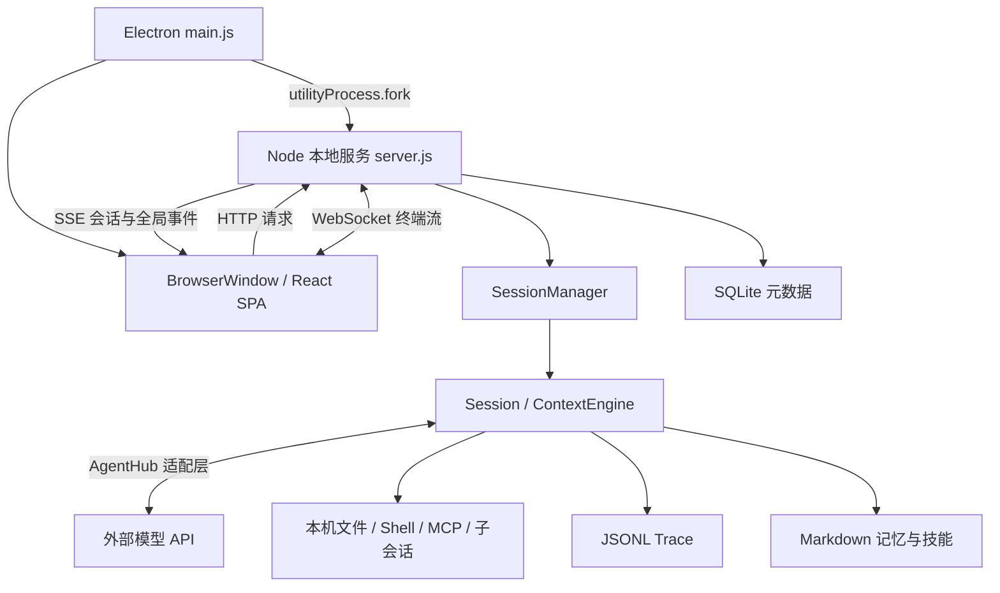

# PenguinHarness 0.2.13 逆向分析

分析日期：2026-10-14。目标：本机 `C:/Program Files/PenguinHarness/resources/app` 的已发布安装包，版本 0.2.13，包内构建日期 2026-09-16。

结论：它实现了一套本地 Agent 运行环境：Electron 桌面壳承载 React 页面，独立 Node 服务负责会话、模型调用、工具、多代理、持久化、记忆和调度。模型能力来自外部模型提供商；产品的主要工程量在模型外围的执行与状态管理。

本报告依据发布 bundle 的静态分析和逐段代码核对；未启动目标、未调用模型、未读取用户凭据或真实会话。代码路径与默认值不代表本机实例已启用相应配置。文中行号只对应这次安装包。

## 1. 程序结构与启动链

安装包直接包含可读的 JavaScript bundle，原有类名、函数名和大量源路径注释仍在，主要机制可以直接追踪，无需先反编译原生机器码。

| 文件/目录 | 作用 |
|---|---|
| `dist/main.js` | Electron 生命周期、窗口、托盘、本地服务拉起与重启 |
| `dist/server.js` | 本地 HTTP 服务、核心 Agent 运行时、存储和业务模块 |
| `dist/penguin.js` | 命令行入口，复用同一套核心能力 |
| `web-dist` | React 网页和静态资源 |
| `dist/node_modules/node-pty` | 原生终端依赖 |
| `node_modules/@penguinharness/*` | 内置技能/Hook 插件资源 |

`startEmbeddedServer()` 用 `utilityProcess.fork()` 启动后台，传入数据根、静态资源路径、`HOST=127.0.0.1`、动态端口及随机 32 字节 desktop token。窗口启用 `contextIsolation`、`sandbox`，关闭 `nodeIntegration`，没有 preload。聊天走同源 HTTP/SSE；桌面控制仍有 utilityProcess 消息，不能说完全没有进程间消息。

桌面先通过一次性 `/claim` token 换取登录 cookie。默认发布版数据根为 `~/.penguin/data`，可由 `PENGUIN_HOME` 覆盖。若同数据根已有服务，桌面附着该服务；后台崩溃最多按 1/2/4 秒延迟重启三次，健康运行 60 秒重置计数。

证据：[main.js 启动](C:/Program%20Files/PenguinHarness/resources/app/dist/main.js:174279)、[窗口](C:/Program%20Files/PenguinHarness/resources/app/dist/main.js:174548)、[登录交换](C:/Program%20Files/PenguinHarness/resources/app/dist/server.js:395075)、[Hono 服务入口](C:/Program%20Files/PenguinHarness/resources/app/dist/server.js:398622)。前端入口为 `web-dist/assets/index-CmfumtXy.js`，其中可见 React 19.2.7。

## 2. 一条用户消息怎样变成连续行动

核心分成三层，而非把所有功能写在一个聊天请求里：

| 层 | 职责 | 发布代码入口 |
|---|---|---|
| Agent | 读取配置，组装提示词、工具、模型和上下文工厂 | `server.js:312181`、`:312236` |
| Session | 管理会话生命周期、Hook、后台通知、恢复与 Trace | `server.js:311517`、`:311687` |
| ContextEngine | 驱动模型与工具循环、重试、中断和上下文压缩 | `server.js:309974`、`:310196` |

实际调用链：

1. 页面 POST `/api/sessions/:id/tasks`，服务端接受后返回 202；`SessionManager` 启动或排队任务。
2. `Agent.assembleContext()` 读取 agent 状态、项目配置、技能元数据、记忆索引、调度信息，组装 system prompt 和工具定义。
3. `Session.runTask()` 进入 `ContextEngine.run()`，用异步生成器向外持续产出统一消息。
4. `GenerativeModel.streamGenerate()` 调用模型；AgentHub 把不同提供商的格式转换为统一事件，再译成应用内部 OmniMessage。
5. 遇到完整的 `tool_call`，执行 Hook 和审批，启动工具，将结果写回模型输入。
6. 有工具结果、后台通知或用户追加指令时继续下一轮；没有后续动作时结束任务。
7. `stop` Hook 还可以返回 `continue`，注入下一条 harness 消息，继续工作。

所以“用户发一次消息，Agent 能执行很多步”来自持续运行的循环与任务状态，而不是每步都需要前端重新提交请求。

模型适配使用 `@prismshadow/agenthub` 的 `AutoLLMClient`，可见依赖版本 0.4.15。适配层处理流式输出、取消、空闲超时、thinking level 和输出 token 上限；输出上限受模型窗口与输入估算约束。认证或确定性请求错误与网络/429/5xx等可重试错误分开处理。输入预算中有启发式估算，不能理解为每次都做精确 tokenizer 计算。

证据：[任务接收](C:/Program%20Files/PenguinHarness/resources/app/dist/server.js:397033)、[上下文组装](C:/Program%20Files/PenguinHarness/resources/app/dist/server.js:312236)、[循环](C:/Program%20Files/PenguinHarness/resources/app/dist/server.js:310196)、[模型适配](C:/Program%20Files/PenguinHarness/resources/app/dist/server.js:304267)。

## 3. 工具执行、并行与权限

`runTurn()` 将模型流和工具流放入 `MergeQueue`。工具调用完成后，先跑 `pre_tool_use` Hook，再进入审批；获准的调用通过异步任务启动，不在当前位置等待工具完成。因而同一轮工具能并行，且模型流尚未全部结束时就能启动已完整的调用。最终交给下一次模型请求的工具结果按原调用顺序整理。

`Environment.executeTool()` 负责解析 JSON 参数、派发名称、超时、取消、错误转换和输出裁剪；工具实现按异步生成器消费。内置工具包括文件读写/编辑、命令执行/输入、子代理启动/输入。Shell 工具通过 Node `spawn` 启动真实本机进程，长任务返回进程 id，后续继续读取输出或写 stdin。

审批策略有 `allow-all`、`deny-all`、`read-only`、`always-ask`。其中只读判断依赖工具元数据；MCP 可依据 `readOnlyHint` 推断或配置覆盖，并不自动证明工具行为只读。

另有 `SandboxService`，源码默认 `danger-full-access`。受限模式要求插件提供 `confine(argv, policy)`，找不到满足能力要求的后端时拒绝命令执行。这里核对到的是命令启动隔离接口；文件工具、MCP stdio、Hook 进程不应据此宣称全部受同一沙箱覆盖。Electron 窗口的 sandbox 也不能等同于 Agent 工具权限。

MCP 使用 SDK 连接层，支持 stdio、Streamable HTTP 与 SSE 回退，工具名映射为 `mcp__server__tool`；支持延迟连接和并行发现。vault 用于进程环境等注入，未把实际秘密读入本报告。

证据：[调用审批与并行](C:/Program%20Files/PenguinHarness/resources/app/dist/server.js:310467)、[Environment](C:/Program%20Files/PenguinHarness/resources/app/dist/server.js:308972)、[MCP](C:/Program%20Files/PenguinHarness/resources/app/dist/server.js:308021)、[审批](C:/Program%20Files/PenguinHarness/resources/app/dist/server.js:367152)、[隔离接口](C:/Program%20Files/PenguinHarness/resources/app/dist/server.js:367776)。

## 4. 子代理如何实现

`run_subagent` 最终创建真实的子 `Session`，具有独立会话 ID、模型上下文和 Trace；继承父工作目录、宿主控制与隔离策略。它不是每个代理一个独立容器，也不会自动给每个代理建立 Git worktree。

默认继承父模型与 thinking，可指定其他 agent 配置或模型。深度上限为 1，子代理的工具列表移除继续生成子代理的工具；管理器容量为 8。消息携带 `origin=sessionId` 以区分来源，子代理审批交回父级。后台完成进入父会话通知队列；运行中可注入 steering，空闲后可继续新任务，运行对象释放后可从持久会话恢复。

共享目录意味着代理能直接协作修改同一组文件，也意味着修改冲突需要上层工作分工协调；这不是文件系统隔离。

证据：[创建子 Session](C:/Program%20Files/PenguinHarness/resources/app/dist/server.js:312606)、[深度与工具过滤](C:/Program%20Files/PenguinHarness/resources/app/dist/server.js:312270)、[管理器](C:/Program%20Files/PenguinHarness/resources/app/dist/server.js:307015)。

## 5. 三种容易混淆的“记住”

| 机制 | 存储与处理 | 目的 |
|---|---|---|
| 会话记录 | JSONL Trace；SQLite 存元数据和派生索引 | 恢复会话、展示历史、统计用量 |
| 上下文压缩 | 让旧上下文生成摘要，再打开新上下文 | 控制模型窗口，接着执行当前任务 |
| 长期记忆 | Markdown 事实文件 + `MEMORY.md` 索引 | 跨会话复用用户偏好、约束和经验 |

Trace 路径形如 `traces/YYYY-MM-DD/sessionId_NNN.jsonl`，忽略 `partial_*` 流式碎片，以追加链保证顺序并支持轮转。SQLite 使用 Node `DatabaseSync`，启用 WAL、busy timeout 和外键；保存项目、agent、会话、设置、调度、用量等。Trace 是会话记录的事实来源，SQLite 相关索引可以重建。恢复先找最新 Trace，再 `resumeSession()`。

长期记忆默认提示词要求模型通过文件工具维护带 frontmatter 的 Markdown，`MEMORY.md` 只保留标题、链接和简短召回提示。上下文注入的是索引，限制 200 行/25000 字符，具体正文按需读文件。作用域分 user 与 workspace，临时工作区只有 user；工作区键由目录名与真实路径 SHA256 前八位构成。这条核对过的链路使用文件索引，不依赖向量检索；不能扩大为整个产品绝无 embedding。

压缩按 token usage 或累计 turn 数触发。阈值取配置与模型窗口减 2048 的较小值；窗口未知默认 128000，配置默认上限 256000，因此该缺省组合阈值为 125952。`summarize` 模式要求旧模型生成非空且没有工具调用的摘要，包装为 `[context_summary]` 用户消息送入新上下文；新上下文重读状态、技能、记忆。失败或中断保留旧上下文，不自动降级丢弃。也提供显式 `discard` 模式。

证据：[Trace Writer](C:/Program%20Files/PenguinHarness/resources/app/dist/server.js:309220)、[SQLite](C:/Program%20Files/PenguinHarness/resources/app/dist/server.js:324061)、[长期记忆指令](C:/Program%20Files/PenguinHarness/resources/app/dist/server.js:301850)、[索引注入](C:/Program%20Files/PenguinHarness/resources/app/dist/server.js:303101)、[压缩触发](C:/Program%20Files/PenguinHarness/resources/app/dist/server.js:310710)、[摘要与新上下文](C:/Program%20Files/PenguinHarness/resources/app/dist/server.js:310780)。

## 6. 技能、持续学习和长期目标

技能/Hook 插件包含 `plugin.json`、`skills/*/SKILL.md` 和可选 `hooks`。常驻提示词先放技能元数据，具体技能正文按需读取。Hook 包括 `user_prompt`、`pre_tool_use`、`stop`，是以 stdin/stdout JSON 通信的外部脚本，可继续任务或请求后台子会话。

一个很具体的“持续学习”实现位于 `@penguinharness/continual-learning`：

- 插件清单 `preinstall:false`，不是所有安装实例默认启用。
- stop Hook 读取刚结束任务的 Trace；完成轮次必须超过 30，且 agent 已有技能。
- 按用户/助手/工具调用/工具输出分类裁剪，摘录总上限 60000 字符。
- 请求一个后台子会话，将可复用发现写回已有 `SKILL.md`，要求简短通用、更新版本、不新建技能。
- 执行效果仍取决于模型与工具权限；这条路径改变技能文件，并没有更新模型权重。

`goal` 插件则用 `GOAL.json` 保存目标、状态、轮次与预算；stop Hook 检查完成/阻塞/中断、累计 token 和轮次上限，必要时注入下一轮消息或收尾消息。代码的轮次上限是 100。持续执行来自 Hook 反馈控制与持久状态文件。

证据：[插件资源读取](C:/Program%20Files/PenguinHarness/resources/app/dist/server.js:302512)、[Session Hook](C:/Program%20Files/PenguinHarness/resources/app/dist/server.js:311687)、[持续学习脚本](<C:/Program Files/PenguinHarness/resources/app/node_modules/@penguinharness/continual-learning/hooks/stop.mjs:19>)、[goal stop Hook](<C:/Program Files/PenguinHarness/resources/app/node_modules/@penguinharness/goal/hooks/stop.mjs:1>)。

## 7. 定时任务、网页实时同步

定时任务由 TOML 定义，SQLite 保存执行状态。调度器每 30 秒扫描，mtime 缓存减少重读，支持 `30m/12h/7d` 等间隔，最短 5 分钟。触发后调用同一个 `runner.startTask`；绑定会话繁忙时用内存 Map 合并排队，每项任务最多保留一个待执行项；未绑定时创建 schedule 来源会话。时间槽以 `start_at` 为锚点，不补齐全部历史周期。因此它是本地调度器，不能等同有持久重试保证的分布式队列。

网页通过 EventSource 订阅会话流和全局流。每会话 Channel 使用随机 epoch 加递增序号，默认保留最多 10000 条/8MiB。重连按 `Last-Event-ID` 回放，过期或 epoch 不同发 `resync_required`，客户端重载状态。终端单独用 WebSocket。

证据：[Scheduler](C:/Program%20Files/PenguinHarness/resources/app/dist/server.js:382956)、[繁忙队列](C:/Program%20Files/PenguinHarness/resources/app/dist/server.js:383182)、[Channel](C:/Program%20Files/PenguinHarness/resources/app/dist/server.js:344175)、[SSE 重连](C:/Program%20Files/PenguinHarness/resources/app/dist/server.js:368795)。

## 8. 服务模块插件和热替换

除了技能资源插件，还存在服务端代码插件：根目录 `plugins.json` 列出包名，动态 import，读取 `ifaces.json`，将默认导出的 `modules` / `replaces` 注册到 `PluginHost`。模块可增加业务能力或按名称替换宿主模块；冲突会拒绝，加载失败记录警告并跳过。两类插件入口和职责不同。

底层 `penguin-core/dist/kernel` 提供接口描述、版本、context 校验、子节点、迁移与资源生命周期。`boot()` 递归装配模块；`park()` 导出 `{v,self,children}` 状态树；`dispose()` 清理子树与 effect。不是仅凭旧教程所说的 Cordis 就能准确描述此版本。

HMR 有实际接线：`/api/hmr` 控制接口接收 platform/CLI/web 更新，保存内容寻址构件，动态 import 新平台，通过状态迁移/校验升级，失败尝试恢复旧版本；成功后一起提交版本清单。进程重启恢复已提交代码，使用新的初始状态，而不是恢复上次内存中的整个模块树。数据库、会话等持久层另行恢复。该路径说明它设计成可更新业务平台，未对热替换成功率做动态测试。

证据：[Kernel](C:/Program%20Files/PenguinHarness/resources/app/dist/server.js:321639)、[PluginHost](C:/Program%20Files/PenguinHarness/resources/app/dist/server.js:344075)、[HMR 升级](C:/Program%20Files/PenguinHarness/resources/app/dist/server.js:344648)、[HMR 控制](C:/Program%20Files/PenguinHarness/resources/app/dist/server.js:345103)、[代码插件加载](C:/Program%20Files/PenguinHarness/resources/app/dist/server.js:398988)、[接入业务树](C:/Program%20Files/PenguinHarness/resources/app/dist/server.js:398412)。

## 9. 如果要实现类似产品

以下是根据已观察结构给出的实现建议，而非声称恢复了原始源码仓库：

先实现统一消息协议与 `Session + 模型/工具循环`，再加模型适配、文件/Shell/MCP、取消与权限；以 JSONL 保存事件并做恢复；随后接 React/SSE 页面、Markdown 记忆、压缩、子会话与调度；最后再加桌面壳和模块热替换。最值得复用的设计是同一事件流同时驱动 UI、Trace、用量、恢复和后台通知。

实现难点集中在：中断后补齐成对的工具调用/输出、流式工具并行、压缩与重试的消息一致性、子任务通知只交付一次、断线后的回放/重同步，以及共享工作目录下的冲突协调。仅复制提示词不能复现这些能力。

## 10. 证据、覆盖与未验证内容

REA 6.4.0 的 `analyze-javascript-application` 处理了安装目录，完整工具输出保存在 [rea-evidence.json](C:/downloads/deepseek-workspace/moyo_memory/analysis/penguinharness-0.2.13/rea-evidence.json)。

- Evidence ID：`ev_d14b20e20b4765ec336e30db86b69ac1681e5044201543dc7b1402c0651131dd`
- 根构件摘要：`7e6ba26c7bb9776cfa34fa5e53b92de2ec889fc414ca590fcdf98f6e5416c43e`
- 119 个相关文件，读取 49736120 字节文本；82 个 JavaScript 文件解析，无 parse failure；记录 5620 个 module 节点。
- 应用图覆盖状态 `partial`；语义图 `partial` 且截断。大 bundle 的扩展关系受父结果预算约束，部分语义分析耗尽 worker heap 或未启动。静态事实仍保留，不能把工具未识别的边理解为不存在。正文关键结论另外逐段核对发布代码，属于人工静态证据，不伪装为 REA 已完整恢复的调用图。
- REA 的 BrowserWindow / utilityProcess 等是静态语法观察，不证明运行时可达、默认值或完整安全策略。

| 核对问题 | 状态 | 证据边界 |
|---|---|---|
| 目标身份与桌面/服务结构 | 已回答 | package 与启动代码 |
| 模型、Agent 循环、工具并行 | 已回答 | 发布代码关键分支 |
| 子代理与共享状态 | 已回答 | 创建/管理/恢复路径 |
| 存储、记忆、压缩 | 已回答 | 存储与上下文处理代码 |
| 技能、持续学习、goal、调度、热替换 | 已回答主要机制 | 未穷举所有业务模块 |
| 当前用户配置、真实运行效果 | 未动态验证 | 未读用户数据、未启动/调用模型 |
| 所有终端原生组件、组织工作流、完整安全性 | 未全面展开 | 本次不作全产品或漏洞审计结论 |

主文件 SHA256（分析前后复核一致）：

| 文件 | SHA256 |
|---|---|
| `dist/main.js` | `3A70E6C4EB0A953551115132E6BCBAFAA35FDCF6D3D1683102781A4EC6963712` |
| `dist/server.js` | `37AB774E64963C8F5389AED1BBE2606DD4A4B057F1CB2E512F2AFA7B2B3CAD49` |
| `dist/penguin.js` | `C27F071DCE2BF93546C2A61006662EB2A06C8F3D7070AC0DC456FE7E1402C2E0` |
